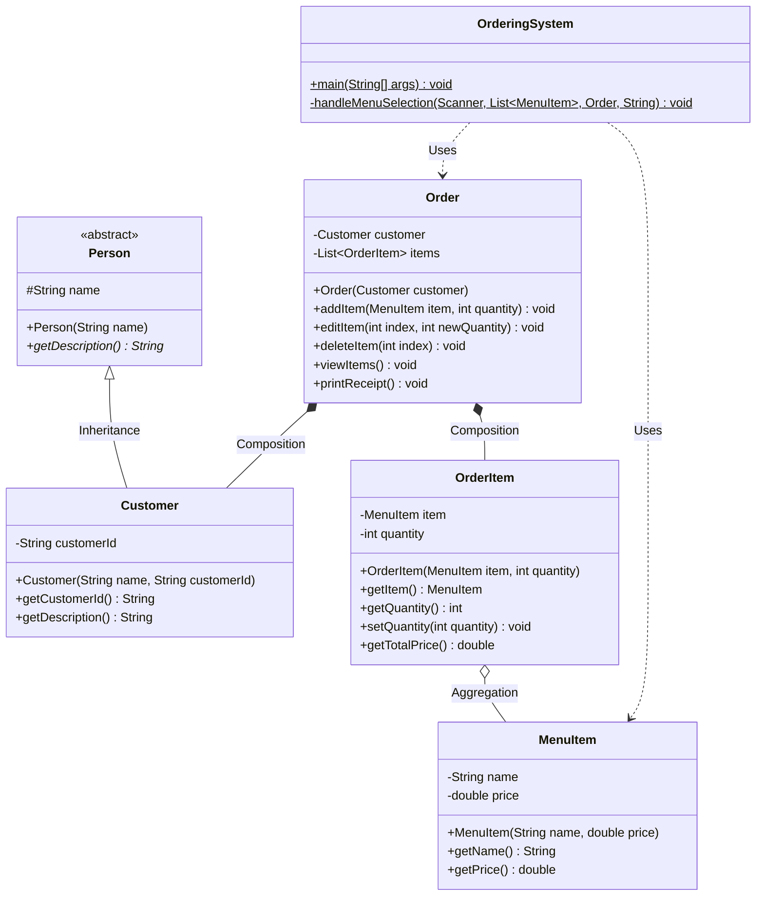

<div align="center">

<!-- Top Restaurant-Themed Animated Wave Banner -->


<!-- Animated Typing SVG -->
<a href="#">
  
</a>

<br/>

<!-- Tech Stack & Project Badges -->
<p>
  
  
  
  
  
</p>

<!-- Quick Navigation -->
<p>
  <a href="#overview">Overview</a> •
  <a href="#menu">Menu Catalog</a> •
  <a href="#architecture">OOP Architecture</a> •
  <a href="#structure">Project Structure</a> •
  <a href="#quickstart">Quick Start</a> •
  <a href="#demo">CLI Demo</a> •
  <a href="#roadmap">Roadmap</a> •
  <a href="#collaboration">Role &amp; Collaboration</a>
</p>

</div>

---

<a name="overview"></a>
## 🍽️ Overview

**Java Ordering System** is a lightweight, restaurant-themed console ordering engine built in Java to demonstrate clean **Object-Oriented Programming (OOP)** architecture, modular domain modeling, and fault-tolerant CLI interaction.

Designed around a real-world dining workflow, the system allows customers to check in with their details, choose whether to browse food or beverages first, manage items dynamically in their cart (view, update quantity, remove), and generate formatted receipts in **Malaysian Ringgit (RM)**.

### ✨ Key Engineering Highlights
- **🧱 Clean Domain Modeling:** Separates guest identity (`Person` / `Customer`), catalog items (`MenuItem`), line items (`OrderItem`), and order state (`Order`) into cohesive classes.
- **🔀 Flexible Ordering Workflow:** Supports customizable browsing order (**Food first** or **Drinks first**) with reusable menu-handling logic (`handleMenuSelection`) and menu-skipping (`0`).
- **🛒 Dynamic Cart Operations:** Full pre-checkout order management allowing customers to inspect current items, modify quantities, or delete items on the fly.
- **🛡️ Defensive Input Handling:** Uses `InputMismatchException` guards and range validation loops to prevent runtime crashes on malformed user inputs.
- **🧾 Automated Receipt Engine:** Computes per-item subtotals and overall totals cleanly with formatted two-decimal currency output (`RM`).

---

<a name="menu"></a>
## 📋 Menu Catalog

<table align="center" width="100%">
  <tr>
    <td width="50%" valign="top">
      <h3 align="center">🍔 Food Menu</h3>
      <table width="100%">
        <thead>
          <tr>
            <th align="center">#</th>
            <th align="left">Dish</th>
            <th align="right">Price (RM)</th>
          </tr>
        </thead>
        <tbody>
          <tr><td align="center">1</td><td>🍔 Burger</td><td align="right">RM 5.99</td></tr>
          <tr><td align="center">2</td><td>🍟 Fries</td><td align="right">RM 2.99</td></tr>
          <tr><td align="center">3</td><td>🍕 Pizza</td><td align="right">RM 8.99</td></tr>
          <tr><td align="center">4</td><td>🍗 Fried Chicken</td><td align="right">RM 10.99</td></tr>
          <tr><td align="center">5</td><td>🥪 Chicken Sandwich</td><td align="right">RM 9.99</td></tr>
          <tr><td align="center">6</td><td>🍗 Chicken Nuggets</td><td align="right">RM 6.99</td></tr>
        </tbody>
      </table>
    </td>
    <td width="50%" valign="top">
      <h3 align="center">🥤 Drink Menu</h3>
      <table width="100%">
        <thead>
          <tr>
            <th align="center">#</th>
            <th align="left">Beverage</th>
            <th align="right">Price (RM)</th>
          </tr>
        </thead>
        <tbody>
          <tr><td align="center">1</td><td>🫧 Soda</td><td align="right">RM 1.50</td></tr>
          <tr><td align="center">2</td><td>🥤 Pepsi</td><td align="right">RM 1.50</td></tr>
          <tr><td align="center">3</td><td>💧 Water</td><td align="right">RM 0.50</td></tr>
          <tr><td align="center">4</td><td>🍊 Fanta</td><td align="right">RM 1.50</td></tr>
          <tr><td align="center">5</td><td>🍎 Apple Juice</td><td align="right">RM 1.50</td></tr>
          <tr><td align="center">6</td><td>☕ Coffee</td><td align="right">RM 1.00</td></tr>
        </tbody>
      </table>
    </td>
  </tr>
</table>

---

<a name="architecture"></a>
## 🏗️ OOP Architecture

The codebase applies **5 core Object-Oriented Programming principles** to keep business logic structured, readable, and extensible:

| OOP Principle | Code Implementation | Engineering Rationale |
| :--- | :--- | :--- |
| **🔒 Encapsulation** | `MenuItem` &amp; `OrderItem` (`private` fields with getters/setters) | Safeguards dish pricing and item quantities against unintended external state mutation. |
| **🧬 Inheritance** | `Customer extends Person` | Reuses base identity properties (`name`) while extending specialized customer attributes (`customerId`). |
| **🧩 Abstraction** | `abstract class Person` defining `abstract String getDescription()` | Establishes a clear contract for any future user roles (e.g., `VIPCustomer`, `Staff`). |
| **🎭 Polymorphism** | `Customer` overrides `Person.getDescription()` | Enables uniform description formatting across subclasses via overridden behavior. |
| **🔗 Composition** | `Order` composes `Customer` and `List<OrderItem>` | Models real-world ownership cleanly while keeping order management decoupled from individual items. |

### 📐 UML Class Diagram



---

<a name="structure"></a>
## 📁 Project Structure

```text
Java-Ordering-System/
├── OrderingSystem.java   # Core OOP domain classes, menu catalog, CLI controller & receipt engine
└── README.md             # Project documentation, UML architecture & usage guide
```

---

<a name="quickstart"></a>
## 🚀 Quick Start

### Prerequisites
- **Java Development Kit (JDK) 8** or later

### Clone, Compile & Run

1. **Clone the repository**
   ```bash
   git clone [https://github.com/yeowzongzheng0215-droid/Java-Ordering-System.git](https://github.com/yeowzongzheng0215-droid/Java-Ordering-System.git)
   cd Java-Ordering-System
   ```

2. **Compile the application**
   ```bash
   javac OrderingSystem.java
   ```

3. **Run in terminal**
   ```bash
   java OrderingSystem
   ```

---

<a name="demo"></a>
## 🖥️ CLI Walkthrough

<details>
<summary><b>Click to expand sample interactive console session</b></summary>

```text
==== WELCOME ====
Enter customer name: Alex
Enter customer ID: C001

Would you like to order:
1. Food first
2. Drinks first
Enter your choice (1 or 2): 1

----- Food Menu -----
1. Burger - RM5.99
2. Fries - RM2.99
3. Pizza - RM8.99
4. Fried Chicken - RM10.99
5. Chicken sandwich - RM9.99
6. Chicken nuggets - RM6.99
Select item number (or 0 to skip this menu): 1
Enter quantity: 2
Select item number (or 0 to skip this menu): 0

----- Drink Menu -----
1. Soda - RM1.50
2. Pepsi - RM1.50
3. Water - RM0.50
4. Fanta  - RM1.50
5. Apple Juice - RM1.50
6. Coffee - RM1.00
Select item number (or 0 to skip this menu): 6
Enter quantity: 1
Select item number (or 0 to skip this menu): 0

Would you like to:
1. View current order
2. Edit item
3. Delete item
4. Print receipt and exit
Enter choice (1-4): 4

==== RECEIPT ====
Customer: Alex (ID: C001)
Burger x2 = RM11.98
Coffee x1 = RM1.00
Total: RM12.98
```

</details>

---

<a name="roadmap"></a>
## 🗺️ Future Roadmap

Planned enhancements to evolve this project into a multi-file, production-style Java application:

- [ ] **Multi-File Package Refactoring:** Split classes into dedicated packages (`model/`, `service/`, `ui/`) for scalable maintainability.
- [ ] **Hardened Validation:** Enforce positive-only quantity checks and add `try-catch` guards to the edit/delete flows.
- [ ] **Receipt Persistence:** Export timestamped order receipts to `.txt` or `.csv` files for sales logging.
- [ ] **Pricing Engine Upgrade:** Support SST tax calculation, combo discounts, and membership tiers via `Person` subclasses.
- [ ] **Unit Testing:** Add JUnit 5 test suites covering cart calculations and edge cases.

---

<a name="collaboration"></a>
## 🤝 Role & Collaboration (50% / 50%)

This project was co-developed by a **2-developer team** with an equal **50% / 50%** engineering split:

<table align="center" width="100%">
  <tr>
    <td width="50%" valign="top">
      <h3 align="center">👨‍💻 YEOW ZONG ZHENG — 50%</h3>
      <p align="center">
        <b>Core OOP Architect &amp; Domain Logic</b><br/>
        <a href="https://github.com/yeowzongzheng0215-droid">@yeowzongzheng0215-droid</a>
      </p>
      <ul>
        <li><b>Domain Class Architecture:</b> Designed and implemented <code>Person</code> (Abstraction), <code>Customer</code> (Inheritance &amp; Polymorphism), <code>MenuItem</code>, and <code>OrderItem</code> (Encapsulation).</li>
        <li><b>Order &amp; Receipt Engine:</b> Built <code>Order</code> composition, cart CRUD methods (<code>addItem</code>, <code>editItem</code>, <code>deleteItem</code>, <code>viewItems</code>), and formatted RM receipt billing.</li>
        <li><b>Documentation &amp; Diagrams:</b> Authored technical documentation and UML architecture diagrams.</li>
      </ul>
    </td>
    <td width="50%" valign="top">
      <h3 align="center">🤝 Co-Developer — 50%</h3>
      <p align="center">
        <b>CLI Workflow &amp; Input Handling</b><br/>
        <i>Project Collaborator</i>
      </p>
      <ul>
        <li><b>Interactive CLI Controller:</b> Built the <code>OrderingSystem</code> main flow, Food/Drink menu initialization, and reusable <code>handleMenuSelection()</code> handler.</li>
        <li><b>Fault-Tolerant Input Validation:</b> Implemented <code>InputMismatchException</code> exception guards and menu choice boundary checks.</li>
        <li><b>Post-Order Management Loop:</b> Built the 1–4 interactive loop for reviewing, modifying, deleting items, and checking out.</li>
      </ul>
    </td>
  </tr>
</table>

---

<div align="center">

<!-- Bottom Warm Wave Footer -->


</div>
