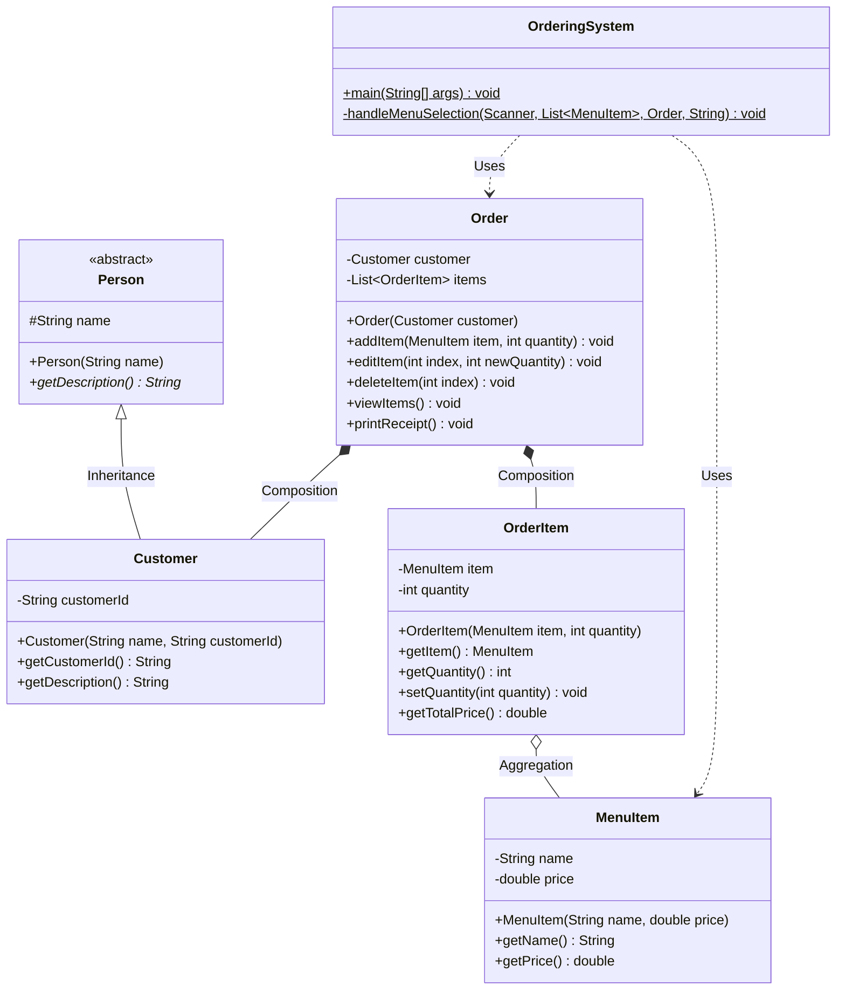

<div align="center">

<!-- Top Restaurant-Themed Animated Wave Banner -->


<!-- Animated Typing SVG -->
<a href="#">
  
</a>

<br/>

<!-- Tech Stack & Assignment Badges -->
<p>
  
  
  
  
  
</p>

<!-- Quick Navigation -->
<p>
  <a href="#-about-the-project">About</a> •
  <a href="#-restaurant-menu">Menu</a> •
  <a href="#-oop-architecture">OOP Design</a> •
  <a href="#-getting-started">How to Run</a> •
  <a href="#-console-preview">Demo</a> •
  <a href="#-team--contributions-50--50">Team (50/50)</a>
</p>

</div>

---

## 🍽️ About The Project

**Java Ordering System** is a restaurant-themed console application developed as a **2-person Group Assignment** to demonstrate core Object-Oriented Programming (OOP) principles in Java.

Diners can enter their customer details, decide whether to browse food or drinks first, customize quantities, edit or remove items in their cart before checkout, and generate an itemized receipt formatted in **Malaysian Ringgit (RM)**.

### ✨ Key Features
- **👤 Customer Registration:** Captures customer name and ID at startup using an abstract `Person` hierarchy.
- **🔀 Flexible Ordering Flow:** Lets diners choose whether to order from the **Food Menu** or **Drink Menu** first, with the option to skip either menu (`0`).
- **🛒 Full Cart Management:** Supports **viewing** the current order, **editing** item quantities, and **deleting** unwanted items before checkout.
- **🛡️ Crash-Proof Input Validation:** Handles invalid non-numeric inputs gracefully via `InputMismatchException` without crashing the application.
- **🧾 Formatted RM Receipt:** Automatically calculates item subtotals and grand totals, printing a clean final receipt upon checkout.

---

## 📋 Restaurant Menu

<table align="center" width="100%">
  <tr>
    <td width="50%" valign="top">
      <h3 align="center">🍔 Food Menu</h3>
      <table width="100%">
        <thead>
          <tr>
            <th align="center">#</th>
            <th align="left">Dish</th>
            <th align="right">Price (RM)</th>
          </tr>
        </thead>
        <tbody>
          <tr><td align="center">1</td><td>🍔 Burger</td><td align="right">RM 5.99</td></tr>
          <tr><td align="center">2</td><td>🍟 Fries</td><td align="right">RM 2.99</td></tr>
          <tr><td align="center">3</td><td>🍕 Pizza</td><td align="right">RM 8.99</td></tr>
          <tr><td align="center">4</td><td>🍗 Fried Chicken</td><td align="right">RM 10.99</td></tr>
          <tr><td align="center">5</td><td>🥪 Chicken Sandwich</td><td align="right">RM 9.99</td></tr>
          <tr><td align="center">6</td><td>🍗 Chicken Nuggets</td><td align="right">RM 6.99</td></tr>
        </tbody>
      </table>
    </td>
    <td width="50%" valign="top">
      <h3 align="center">🥤 Drink Menu</h3>
      <table width="100%">
        <thead>
          <tr>
            <th align="center">#</th>
            <th align="left">Beverage</th>
            <th align="right">Price (RM)</th>
          </tr>
        </thead>
        <tbody>
          <tr><td align="center">1</td><td>🫧 Soda</td><td align="right">RM 1.50</td></tr>
          <tr><td align="center">2</td><td>🥤 Pepsi</td><td align="right">RM 1.50</td></tr>
          <tr><td align="center">3</td><td>💧 Water</td><td align="right">RM 0.50</td></tr>
          <tr><td align="center">4</td><td>🍊 Fanta</td><td align="right">RM 1.50</td></tr>
          <tr><td align="center">5</td><td>🍎 Apple Juice</td><td align="right">RM 1.50</td></tr>
          <tr><td align="center">6</td><td>☕ Coffee</td><td align="right">RM 1.00</td></tr>
        </tbody>
      </table>
    </td>
  </tr>
</table>

---

## 🏗️ OOP Architecture

This project implements all **5 core Object-Oriented Programming concepts** inside `OrderingSystem.java`:

| OOP Concept | Implementation in Code | Purpose |
| :--- | :--- | :--- |
| **🔒 Encapsulation** | `MenuItem`, `OrderItem` (`private` fields + getters/setters) | Protects dish prices, names, and order quantities from unauthorized modification. |
| **🧬 Inheritance** | `Customer extends Person` | Reuses base guest attributes (`name`) and extends them with `customerId`. |
| **🧩 Abstraction** | `abstract class Person` with `abstract String getDescription()` | Defines a contract that all guest subclasses must implement. |
| **🎭 Polymorphism** | `Customer` overrides `Person.getDescription()` | Allows parent-type (`Person`) references to invoke subclass-specific descriptions. |
| **🔗 Composition** | `Order` holds a `Customer` and `List<OrderItem>` | Builds a complete order object from independent customer and line-item components. |

### 📐 UML Class Diagram



---

## 🚀 Getting Started

### Prerequisites
- **Java Development Kit (JDK) 8** or higher installed on your machine.

### Installation & Execution

1. **Clone the repository**
   ```bash
   git clone [https://github.com/yeowzongzheng0215-droid/Java-Ordering-System.git](https://github.com/yeowzongzheng0215-droid/Java-Ordering-System.git)
   cd Java-Ordering-System
   ```

2. **Compile the Java source file**
   ```bash
   javac OrderingSystem.java
   ```

3. **Run the application**
   ```bash
   java OrderingSystem
   ```

---

## 🖥️ Console Preview

<details>
<summary><b>Click to expand sample terminal session</b></summary>

```text
==== WELCOME ====
Enter customer name: Alex
Enter customer ID: C001

Would you like to order:
1. Food first
2. Drinks first
Enter your choice (1 or 2): 1

----- Food Menu -----
1. Burger - RM5.99
2. Fries - RM2.99
3. Pizza - RM8.99
4. Fried Chicken - RM10.99
5. Chicken sandwich - RM9.99
6. Chicken nuggets - RM6.99
Select item number (or 0 to skip this menu): 1
Enter quantity: 2
Select item number (or 0 to skip this menu): 0

----- Drink Menu -----
1. Soda - RM1.50
2. Pepsi - RM1.50
3. Water - RM0.50
4. Fanta  - RM1.50
5. Apple Juice - RM1.50
6. Coffee - RM1.00
Select item number (or 0 to skip this menu): 6
Enter quantity: 1
Select item number (or 0 to skip this menu): 0

Would you like to:
1. View current order
2. Edit item
3. Delete item
4. Print receipt and exit
Enter choice (1-4): 4

==== RECEIPT ====
Customer: Alex (ID: C001)
Burger x2 = RM11.98
Coffee x1 = RM1.00
Total: RM12.98
```

</details>

---

## 👥 Team & Contributions (50% / 50%)

This project was developed collaboratively as a **2-person Group Assignment** with an equal **50% / 50%** workload distribution:

<table align="center" width="100%">
  <tr>
    <td width="50%" valign="top">
      <h3 align="center">👨‍💻 YEOW ZONG ZHENG — 50%</h3>
      <p align="center">
        <b>OOP Architecture & Core Logic</b><br/>
        <a href="https://github.com/yeowzongzheng0215-droid">@yeowzongzheng0215-droid</a>
      </p>
      <ul>
        <li><b>Core OOP Model Design:</b> Designed <code>Person</code> (Abstraction), <code>Customer</code> (Inheritance &amp; Polymorphism), <code>MenuItem</code>, and <code>OrderItem</code> (Encapsulation).</li>
        <li><b>Order Management Logic:</b> Implemented <code>Order</code> composition, item add/edit/delete methods, and formatted RM receipt generation.</li>
        <li><b>Architecture Documentation:</b> Structured OOP comments and verified calculation accuracy.</li>
      </ul>
    </td>
    <td width="50%" valign="top">
      <h3 align="center">🤝 Group Partner — 50%</h3>
      <p align="center">
        <b>CLI Flow &amp; Input Handling</b><br/>
        <i>Co-Author &amp; Assignment Teammate</i>
      </p>
      <ul>
        <li><b>Interactive CLI Flow:</b> Built the <code>OrderingSystem</code> main workflow, Food/Drink menu setup, and reusable <code>handleMenuSelection()</code> method.</li>
        <li><b>Input Validation &amp; Exception Handling:</b> Implemented <code>InputMismatchException</code> safeguards and menu boundary checks.</li>
        <li><b>Post-Order Editing Loop:</b> Implemented the 1–4 interactive loop for viewing, updating, deleting items, and checkout.</li>
      </ul>
    </td>
  </tr>
</table>

---

<div align="center">

<!-- Bottom Warm Wave Footer -->


</div>
